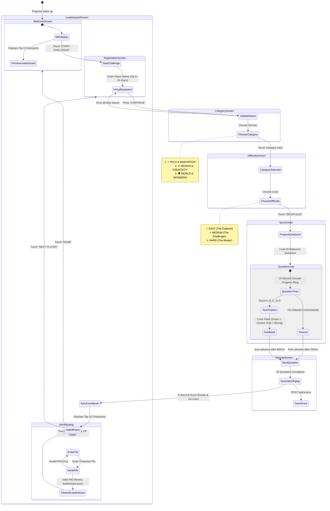
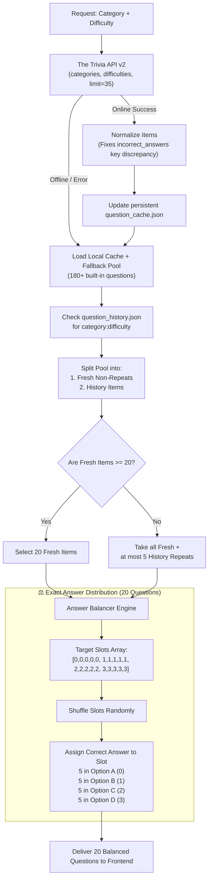

# 🎯 Quiz Arena — Interactive LiDAR Touch Quiz Station

An interactive, large-scale projection wall quiz installation powered by **LDROBOT LD19 2D LiDAR** laser touch tracking, an event-driven **Python backend**, and a responsive **1490 × 800 digital stage** built in Vanilla Web technologies.

Designed for museum exhibits, science centers, interactive brand activations, corporate experience centers, and live event gamification.

---

## 📸 Interactive System Overview & Flow

### 1. Complete System Architecture

```mermaid
flowchart TB
    subgraph Physical_Installation["🏛️ Physical Installation (149\" × 80\" Wall)"]
        Wall["📽️ Projection Surface (1490 × 800 px Stage)"]
        UserTouch["👆 User Physical Touch / Hand Tap"]
        LiDAR["📡 LDROBOT LD19 LiDAR (COM7, 230400 Baud)"]
        Projector["📽️ Short-Throw / Ultra-Short-Throw Projector"]
    end

    subgraph Hardware_Controller["⚙️ Python Hardware Controller (lidar.py)"]
        SerialReader["Serial Reader (47-byte Packets, CRC8)"]
        CoordinateMapper["Polar to Cartesian Transform (Inches & MM)"]
        DeadzoneFilter["Deadzone Filter (4\" Left & Right Bounds)"]
        ClusterTracker["Cluster Tracker & Touch ID State Machine"]
        TkinterGUI["🖥️ Tkinter Wall Calibration & Simulation Monitor"]
        UDPSender["UDP Socket Emitter (Port 5005)"]
    end

    subgraph Backend_Server["🚀 Python Backend Server (server.py)"]
        UDPReceiver["UDP Event Ingest (Port 5005)"]
        SSEStreamer["SSE Event Streamer (/api/events)"]
        APIRouter["REST API Engine (/api/questions, /api/scores)"]
        LeaderboardEngine["Leaderboard Store (data/leaderboard.json)"]
        AdminReset["🔐 Admin PIN Verification (/api/admin/leaderboard)"]
    end

    subgraph Question_Provider["🧠 Question Provider Engine (question_provider.py)"]
        TriviaAPI["🌐 The Trivia API v2 (Science, Arts, General)"]
        CacheLayer["💾 Persistent Cache (data/question_cache.json)"]
        RepeatGuard["🛡️ Repeat Guard (Max 5 Repeats / Session)"]
        AnswerBalancer["⚖️ Balanced Answer Distributer (5 A's, 5 B's, 5 C's, 5 D's)"]
        FallbackPool["📦 180+ Curated Offline Fallback Questions"]
    end

    subgraph Display_Client["💻 Front-End Game UI (index.html)"]
        BrowserWindow["🖥️ Chrome Fullscreen (F11)"]
        EventSourceClient["SSE Client (EventSource)"]
        HitTester["Touch Coordinate Hit-Tester (x_norm, y_norm)"]
        StageManager["7-Screen Dynamic State Machine"]
    end

    UserTouch -->|Breaks Laser Plane| LiDAR
    LiDAR -->|Serial Data Stream| SerialReader
    SerialReader --> CoordinateMapper --> DeadzoneFilter --> ClusterTracker
    ClusterTracker --> TkinterGUI
    ClusterTracker -->|touch_down / touch_move / touch_up| UDPSender
    UDPSender -->|JSON Packets| UDPReceiver
    UDPReceiver -->|Broadcast Events| SSEStreamer
    SSEStreamer -->|Real-time SSE data| EventSourceClient
    EventSourceClient --> HitTester --> StageManager

    TriviaAPI -.->|Dynamic Questions| Question_Provider
    FallbackPool -.->|Offline Mode| Question_Provider
    Question_Provider --> AnswerBalancer --> APIRouter
    APIRouter <-->|Questions & Scores| BrowserWindow
    BrowserWindow -->|Displays Visual Output| Projector
    Projector -->|Projects Game| Wall
```

---

### 2. Player Journey & Screen State Flow



---

### 3. LiDAR Touch Processing & Calibration Pipeline

```mermaid
flowchart LR
    A["Raw Serial Bytes<br/>(47-byte Packet @ 230400 Baud)"] --> B["Header & CRC8<br/>Validation (0x54, 0x2C)"]
    B --> C["Polar-to-Cartesian<br/>x = X_sensor + d·sin(θ)<br/>y = Y_sensor + d·cos(θ)"]
    C --> D["Wall Boundary & Deadzones<br/>X: 4\" to 145\" (149\" Total)<br/>Y: 0\" to 80\""]
    D --> E["Spatial Clustering<br/>Euclidean Grouping<br/>(Min 2 Pts, Dist < 3.5\")"]
    E --> F["Touch State Machine<br/>• touch_down (New)<br/>• touch_move (Delta)<br/>• touch_up (Release)"]
    F --> G["UDP 127.0.0.1:5005<br/>JSON Dispatch"]
    G --> H["server.py SSE Bridge<br/>/api/events"]
    H --> I["Browser stage.hitTest(x, y)<br/>Triggers HTML button.click()"]
```

---

### 4. Question Provider & Repeat Protection Pipeline



---

## 📐 Physical Wall & Calibration Dimensions

The interactive station is calibrated for the following standard physical setup:

| Parameter | Calibrated Value | Notes |
|---|---|---|
| **Projection Wall Width** | `149.0 inches` (3,784.6 mm) | Horizontal projection width |
| **Projection Wall Height** | `80.0 inches` (2,032.0 mm) | Vertical projection height |
| **Left Dead Zone** | `4.0 inches` (101.6 mm) | Prevents perimeter wall bounces |
| **Right Dead Zone** | `4.0 inches` (101.6 mm) | Prevents edge false-positives |
| **Active Touch Width** | `141.0 inches` (3,581.4 mm) | Usable interactive area |
| **Sensor Default Position** | `X = 74.5"`, `Y = 38.0"` | Mid-height center or edge mounted |
| **Digital Stage Resolution** | `1490 × 800 px` | 10 pixels per inch (PPI = 10) |
| **Stage Auto-Scaling** | Fullscreen proportional `scale(s)` | Automatically scales to any display |

```
|<--------------------------------- 149 INCHES --------------------------------->|
+-------------------+-----------------------------------------+-------------------+
|   4" DEAD ZONE    |         141" ACTIVE TOUCH AREA          |   4" DEAD ZONE    |
| (Ignored Touches) |                                         | (Ignored Touches) |
|                   |                                         |                   |
|                   |                    ★                    |                   |
|                   |           LD19 Sensor (Y = 38")         |                   |
|                   |                                         |                   |
|                   |                                         |                   |
+-------------------+-----------------------------------------+-------------------+
0"                  4"                                        145"               149"
```

---

## 🗂️ Project File Structure

```
interactive-quiz-station/
├── index.html              # 7-Screen Web UI, 1490x800 Stage, LiDAR Touch Engine
├── server.py               # HTTP REST Server, SSE Bridge, UDP Ingest, Leaderboard Store
├── question_provider.py    # Trivia API fetcher, 180+ Fallbacks, Repeat Guard, Answer Balancer
├── lidar.py                # LD19 Serial Parser, Wall Mapper, Touch Clustering, Tkinter Monitor
├── requirements.txt        # Python dependencies (pyserial)
├── .gitignore              # Clean git exclusions
└── data/                   # Persistent runtime data (Auto-created)
    ├── leaderboard.json    # Champions Hall of Fame scores
    ├── question_cache.json # Cached API questions
    └── question_history.json # Per-category question history for repeat prevention
```

---

## ⚡ Quick Start & Run Instructions

### 1. Prerequisites
- **Python 3.9+** installed on Windows.
- Google Chrome or Microsoft Edge browser.
- (Optional) **LDROBOT LD19 LiDAR** sensor connected via USB-UART on `COM7`.
  *(If the sensor is not plugged in, the system automatically launches in **Interactive Mouse Simulation Mode**).*

### 2. Install Dependencies
Open PowerShell in the project directory:

```powershell
pip install -r requirements.txt
```

*(Note: `server.py` and `question_provider.py` use only Python standard library modules!)*

---

### 3. Running the System

You will need **two terminal windows**:

#### Terminal 1 — Start the Quiz Server
Set your private Hall of Fame reset PIN and start the server:

```powershell
$env:QUIZ_ADMIN_PIN="YourPrivatePIN123"
python server.py
```

*Output:*
```
============================================================
  QUIZ ARENA - INTERACTIVE QUIZ BACKEND SERVER
  HTTP Interface: http://127.0.0.1:8000
  LiDAR UDP Ingest: udp://127.0.0.1:5005
  Admin PIN: **************** (configured via QUIZ_ADMIN_PIN)
============================================================
```

#### Terminal 2 — Start the LD19 LiDAR Controller
```powershell
python lidar.py
```

*What happens:*
- Reads telemetry from `COM7` at `230400` baud.
- Opens the **Wall Calibration & Monitor Window**.
- If hardware is connected: tracks real hands touching the wall.
- If hardware is disconnected: enables **Simulation Mode** — click and drag on the Tkinter canvas to simulate touches!

#### Terminal 3 — Launch the Game on Projector
1. Open Google Chrome and navigate to:
   ```
   http://localhost:8000
   ```
2. Press **`F11`** to enter fullscreen mode.
3. The bottom-right status pill will read: `LiDAR bridge connected`.

---

## 🎮 Game Screen Specifications

| Screen | Function | Interaction Details |
|---|---|---|
| **1. Welcome** | Idle Attraction Loop | "START CHALLENGE", Top 5 Hall of Fame preview, feature badges |
| **2. Registration** | Player Identification | Full on-screen QWERTY touch keyboard, backspace, clear, max 24 chars |
| **3. Category Selection** | Topic Selection | ⚡ Tech & Innovation, ✦ Design & Creativity, 🌍 World & Wonders |
| **4. Difficulty Selection** | Challenge Tuning | 🌱 Easy (The Explorer), ⚡ Medium (The Challenger), 🔥 Hard (The Master) |
| **5. Quiz Arena** | Active 20 Questions | 15s conic timer, live scoring (+100 for correct + up to +50 speed bonus), instant color feedback |
| **6. Results** | Performance Review | Final score, correct/wrong/unanswered counts, accuracy %, 6-second transition ticker |
| **7. Leaderboard** | Hall of Fame | Top 10 rankings, category, level, accuracy, time used, "DONE", "NEXT PLAYER" |
| **Admin Dialog** | Score Reset | Password-protected modal. Validates `X-Admin-Pin`. Clears only `leaderboard.json` |

---

## ⚖️ Balanced Answer Distribution Guarantee

Unlike typical trivia games where random selection creates streaks of "B" or "C", Quiz Arena guarantees a **statistically fair answer distribution**:

- For every 20-question session:
  - **Exactly 5 questions** have the correct answer on **A**
  - **Exactly 5 questions** have the correct answer on **B**
  - **Exactly 5 questions** have the correct answer on **C**
  - **Exactly 5 questions** have the correct answer on **D**
- The positions are shuffled randomly across the 20 questions so players cannot predict the order.

---

## 🛡️ Question Repeat Prevention & Caching

- **History Separation**: Each combination of `(Category × Difficulty)` maintains its own isolated question history in `data/question_history.json`.
- **Repeat Ceiling**: An active game will have at most **5 questions** from the immediate previous session in the same category/difficulty.
- **Offline Resiliency**: In the event of Wi-Fi loss, network latency, or API downtime, the system automatically falls back to its built-in database of 180+ curated questions without interrupting gameplay.

---

## 🔒 Security & Admin Management

The Hall of Fame reset is protected:
- The reset endpoint is `DELETE /api/admin/leaderboard`.
- Protected by constant-time `hmac.compare_digest` validation against the `QUIZ_ADMIN_PIN` environment variable (defaults to `1234` if unset).
- Touch layer blocks access: the physical LiDAR hit-tester explicitly ignores the Admin Reset button, requiring an administrator with physical keyboard/mouse access to trigger resets.
- Data isolation: Resetting only clears `data/leaderboard.json`; calibration, question caches, and question histories are preserved.

---

## 🛠️ Calibration & Troubleshooting

### 1. Serial Port Error (`COM7` not found)
- Open Device Manager on Windows and locate your USB-to-UART bridge (CP2102, FTDI, or CH340).
- Check the COM port assigned (e.g., `COM3`, `COM5`).
- Override the port via environment variable:
  ```powershell
  $env:LIDAR_PORT="COM5"
  python lidar.py
  ```

### 2. Projector Parallax Offset
- In the `lidar.py` Tkinter window, use the **Sensor X**, **Sensor Y**, and **Angle Offset** sliders to match laser points to your projector's image boundaries.
- Adjust `DEAD_LEFT_IN` or `DEAD_RIGHT_IN` if light reflections on adjacent walls trigger ghost clicks.

### 3. API Key (Optional)
- For high-volume public exhibits, obtain a commercial key from [The Trivia API](https://the-trivia-api.com) and set:
  ```powershell
  $env:TRIVIA_API_KEY="your-api-key-here"
  ```

---

## 📄 License
MIT License — Free to use, adapt, and deploy for educational and commercial interactive installations.
